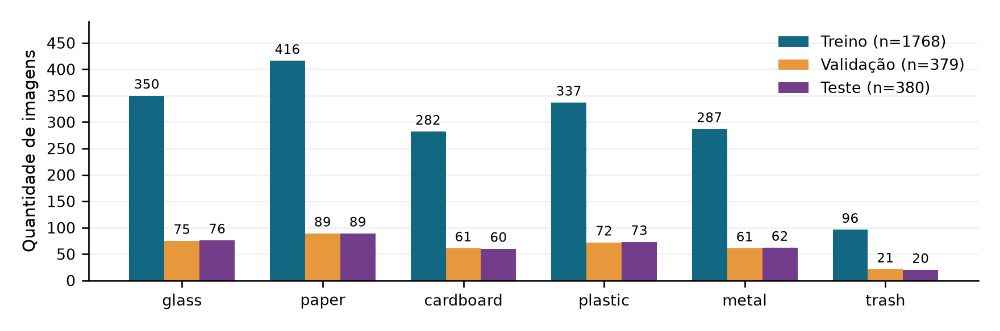
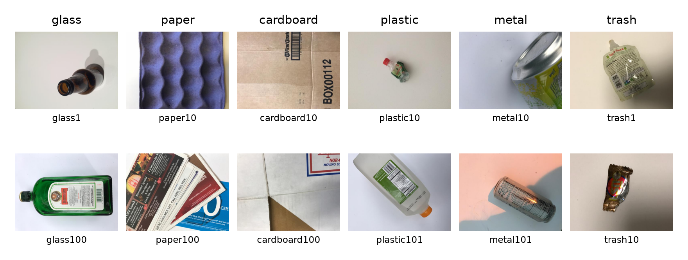
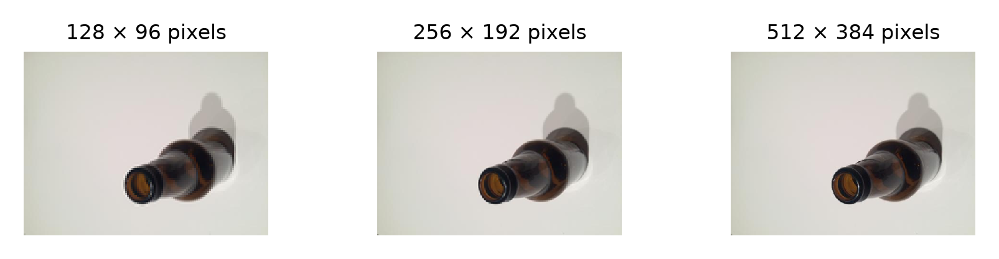
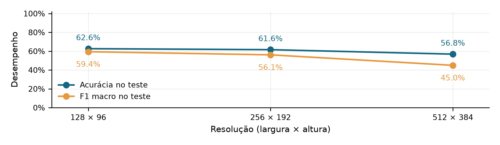
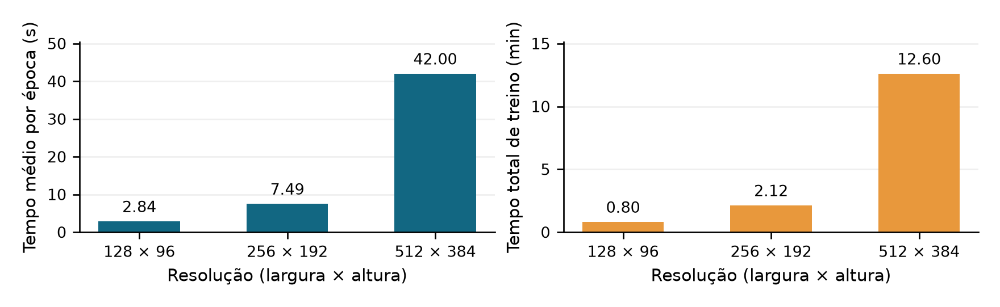
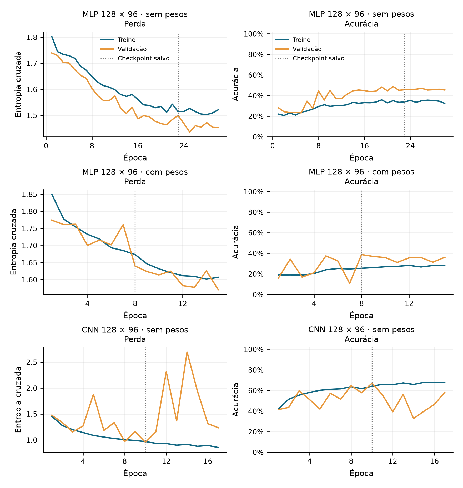
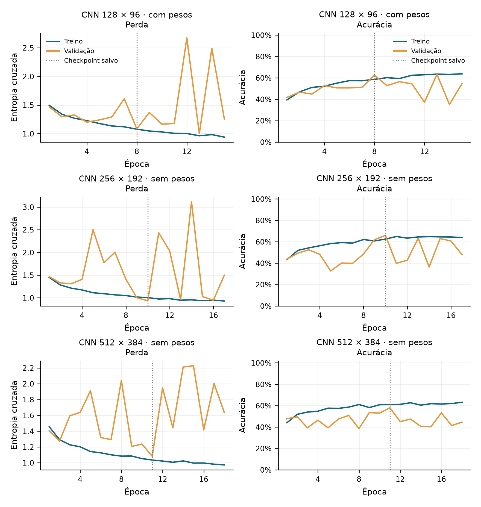
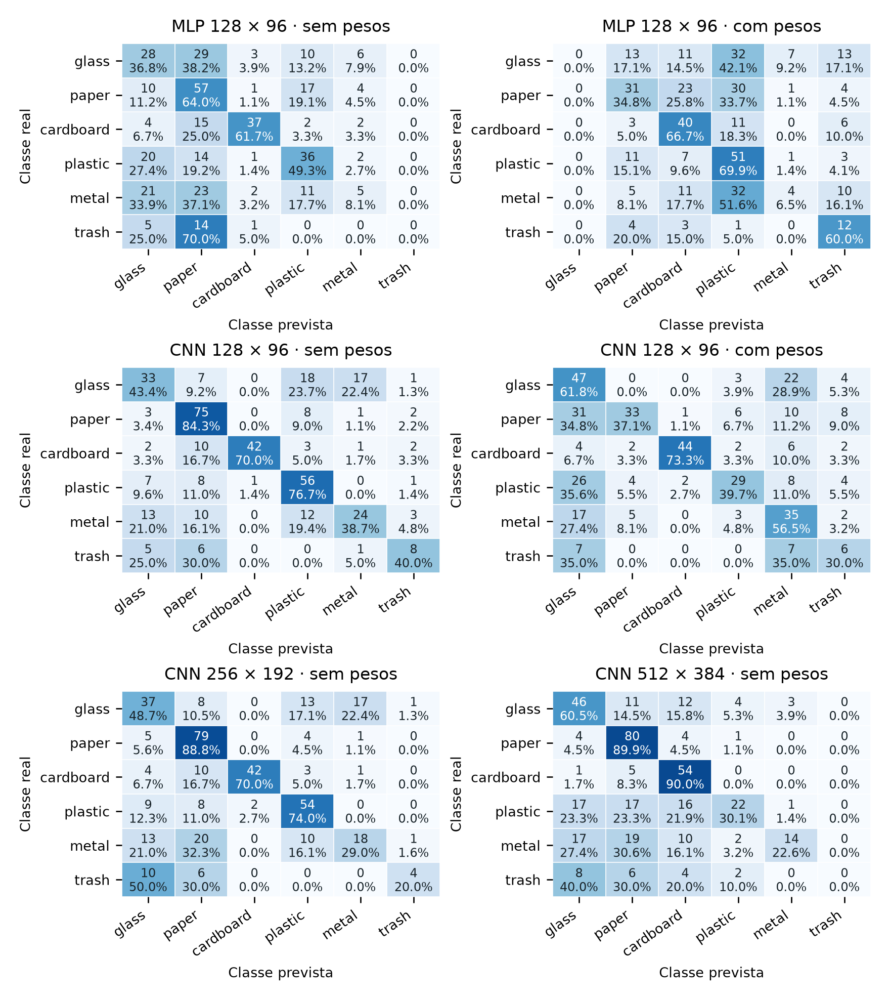
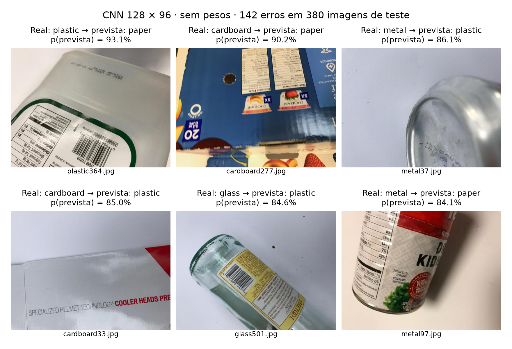

Classificação de resíduos no TrashNet: comparação entre MLP e CNN, ponderação de classes e resolução

Grupo 1

Lorem Ipsum (matrícula 9999999); Lorem Ipsum (matrícula 9999999); Lorem Ipsum (matrícula 9999999); Lorem Ipsum (matrícula 9999999)

GitHub: <link href="https://github.com/Redes-Neurais-Unifor-Grupo-1/Redes-Neurais-Unifor-Grupo-1">https://github.com/Redes-Neurais-Unifor-Grupo-1/Redes-Neurais-Unifor-Grupo-1</link>

Resumo

Este estudo compara redes perceptron multicamadas (MLP) e convolucionais (CNN) na classificação de seis categorias do TrashNet. Foram executados seis experimentos controlados: ambas as arquiteturas em 128 × 96 pixels, com e sem ponderação de classes, e a mesma CNN sem pesos em 256 × 192 e 512 × 384 pixels. A partição estratificada contém 1768 imagens de treino, 379 de validação e 380 de teste. Três pares de imagens idênticas com rótulos conflitantes foram mantidos dentro de uma única partição por par, evitando vazamento. A seleção utilizou exclusivamente F1 macro de validação. O modelo escolhido, CNN 128, obteve 62,6% de acurácia e 0,594 de F1 macro no teste. As diferenças de desempenho são discutidas em conjunto com tempo, memória, desequilíbrio e limitações do conjunto. Os achados descrevem uma única semente e partição, sem inferência de superioridade estatística.

<b>Palavras-chave:</b> redes neurais; classificação de imagens; TrashNet; desequilíbrio de classes; custo computacional.

1 Introdução

A identificação visual de materiais pode apoiar sistemas de triagem de resíduos, mas diferenças de aparência dentro de uma categoria e semelhanças entre materiais tornam a classificação desafiadora. O TrashNet reúne objetos fotografados em condições relativamente controladas e permite estudar esse problema em escala computacional acessível (Thung; Yang, [2016]).

O objetivo é investigar três questões: como MLP e CNN se comportam sob condições equivalentes; como pesos inversos à frequência afetam as classes, especialmente <i>trash</i>; e se aumentar a resolução da CNN produz ganhos compatíveis com seu custo. A comparação é controlada, sem pré-treinamento, e prioriza F1 macro para dar igual importância às seis categorias.

2 Materiais e métodos

Utilizou-se exclusivamente o arquivo <i>dataset-resized.zip</i> indicado na atividade, com 2.527 imagens. A ordem das classes em toda a análise é glass, paper, cardboard, plastic, metal e trash, com 501, 594, 403, 482, 410 e 137 arquivos, respectivamente. A razão entre a maior e a menor classe é 4,34:1. A auditoria confirmou imagens RGB de 512 × 384 pixels, sem arquivos corrompidos.

---

2.1 Partição, integridade e pré-processamento

A divisão estratificada usou <i>train_test_split</i> e semente 42: 70% para treino e duas metades do restante para validação e teste (1768/379/380). Os manifestos registram caminho, rótulo, partição e hashes SHA-256 do arquivo e dos pixels. Encontraram-se três pares idênticos com rótulos divergentes: glass115/metal91, glass176/plastic152 e glass389/plastic332. Preservaram-se os rótulos e as contagens por classe de cada conjunto. Uma troca determinística entre arquivos da mesma classe (plastic332 por plastic1) reuniu os três pares no treino. A troca não dependeu de métricas dos modelos.

Cada resolução foi gerada diretamente da referência, com conversão RGB e interpolação Lanczos; 512 × 384 preserva o tamanho original. Os pixels foram divididos por 255, sem estimar estatísticas no teste. Não houve aumento, reamostragem ou exclusão da classe trash. Os caches foram preparados antes da medição de tempo. Em PyTorch, a entrada segue lote × canais × altura × largura.

2.2 Arquiteturas e treinamento

A MLP achata os 36.864 valores RGB e utiliza camadas densas de 128 e 64 unidades, ReLU e dropout de 0,3, seguidas por seis logits (4.727.366 parâmetros). A CNN usa convoluções 3 × 3 com 16, 32 e 64 filtros, padding 1, BatchNorm, ReLU e max-pooling 2 × 2 em cada bloco; a primeira convolução tem passo 2. Global average pooling, dropout de 0,3 e uma camada linear de seis saídas completam a rede (24.198 parâmetros em todas as resoluções).

A MLP fornece uma referência sem estrutura espacial explícita. Na CNN, compartilhamento de filtros e agregação global reduzem parâmetros e permitem variar apenas a resolução. PyTorch (Paszke et al., 2019) implementa as redes; NumPy (Harris et al., 2020), pandas (McKinney, 2010), Matplotlib (Hunter, 2007) e Pillow (2026) apoiam dados e figuras. Usou-se Adam (Kingma; Ba, 2015) por sua adaptação das atualizações, lote 32 para caber na RAM, semente 42 e sem decaimento de pesos. A entropia cruzada recebe logits e expressa o erro multiclasse. O orçamento fixo de 30 épocas e a paciência 7 limitam custo e conservam a melhor validação.

O melhor checkpoint maximiza F1 macro de validação; empate usa menor perda. Só a melhoria estrita de F1 reinicia a paciência. A ponderação usa peso(c) = N / (6 × n(c)), com N como total de treino e n(c) como contagem da classe c no treino. Arquitetura, inicialização, ordem dos lotes e demais configurações são preservadas entre os pares com e sem pesos. A extensão YOLO não foi realizada.

Tabela 1 - Busca preliminar na MLP sem pesos, antes do teste. Demais configurações iguais às descritas acima; custos separados dos seis treinos finais.

| Taxa Adam | F1 macro val. | Época salva / total | Tempo total (s) |
| --- | --- | --- | --- |
| 0,0001 | 0,383 | 23/30 | 79,4 |
| 0,0003 | 0,128 | 3/10 | 24,6 |
| 0,0010 | 0,063 | 1/8 | 16,5 |

Fonte: artifacts/search. A taxa 0,0001 venceu pela validação e foi aplicada a dois novos treinos MLP. As CNNs mantiveram 0,001, taxa inicial fixa. As taxas distintas limitam atribuir diferenças entre MLP e CNN somente à arquitetura; a busca não demonstra otimalidade.

2.3 Avaliação e custo

A avaliação dos seis checkpoints no mesmo teste ocorreu após concluir treinos e seleção por validação. Usou-se scikit-learn (Pedregosa et al., 2011), seis rótulos e <i>zero_division=0</i>: razões indefinidas recebem zero. F1 macro é a média dos seis F1. O tempo inclui treino e validação por época, excluindo download, preparação e gravação de checkpoints. Cada experimento roda em processo próprio. RSS é amostrado a cada 100 ms no laço, incluindo salvamentos e páginas mapeadas, e mede memória do processo.

---

3 Resultados: análise exploratória

A estratificação mantém a predominância de paper e a menor representação de trash (Figura 1). Os exemplos da Figura 2 são do treinamento. Variações de cor, formato, transparência, amassamento e iluminação podem aproximar materiais diferentes. Os três tamanhos da Figura 3 preservam a proporção 4:3; detalhes finos podem desaparecer na redução.

Figura 1 - Quantidade de imagens por classe e conjunto.

Fonte: TrashNet (Thung; Yang, [2016]); processamento descrito neste estudo.

Figura 2 - Dois exemplos de treino de cada classe do TrashNet.

Fonte: TrashNet (Thung; Yang, [2016]); processamento descrito neste estudo.

Figura 3 - A mesma imagem nas três resoluções de entrada (largura × altura).

Fonte: TrashNet (Thung; Yang, [2016]); processamento descrito neste estudo.

Os seis arquivos de três pares conflitantes constituem 0,24% do conjunto. Agrupar duplicatas evita vazamento exato, mas não corrige ruído de rótulo nem comprova ausência de objetos repetidos ou imagens quase idênticas.

---

3.1 Desempenho global e custo computacional

Tabela 2 - Validação e teste dos seis experimentos; pesos referem-se à função de perda.

| ID | Modelo | Entrada | Pesos | F1 val. | Acur. teste | F1 teste |
| --- | --- | --- | --- | --- | --- | --- |
| E1 | MLP | 128 × 96 | Não | 0,383 | 42,9% | 0,354 |
| E2 | MLP | 128 × 96 | Sim | 0,334 | 36,3% | 0,303 |
| E3 | CNN | 128 × 96 | Não | 0,633 | 62,6% | 0,594 |
| E4 | CNN | 128 × 96 | Sim | 0,619 | 51,1% | 0,500 |
| E5 | CNN | 256 × 192 | Não | 0,574 | 61,6% | 0,561 |
| E6 | CNN | 512 × 384 | Não | 0,472 | 56,8% | 0,450 |

Fonte: registros dos experimentos. Seleção: maior F1 de validação, antes do teste.

Tabela 3 - Custo medido; época escolhida / épocas executadas e tamanho do checkpoint.

| ID | Parâmetros | Modelo MiB | Épocas | Total s | s/época | RSS MiB |
| --- | --- | --- | --- | --- | --- | --- |
| E1 | 4.727.366 | 18,04 | 23/30 | 82,9 | 2,8 | 645,1 |
| E2 | 4.727.366 | 18,04 | 8/15 | 37,0 | 2,5 | 643,4 |
| E3 | 24.198 | 0,10 | 10/17 | 48,3 | 2,8 | 572,9 |
| E4 | 24.198 | 0,10 | 8/15 | 32,6 | 2,2 | 571,9 |
| E5 | 24.198 | 0,10 | 10/17 | 127,3 | 7,5 | 969,2 |
| E6 | 24.198 | 0,10 | 11/18 | 756,0 | 42,0 | 2305,3 |

Fonte: perf_counter e RSS do processo. MiB = 2<super>20</super> bytes; tamanho do arquivo com pesos e metadados.

Hardware: Intel Core i3-1125G4; 14,8 GiB de RAM; quatro threads CPU, sem GPU. Python 3.14.4; PyTorch 2.14.1+cpu; lote 32 em todos os treinos. Tempos de parede dependem também da carga do sistema, que não é dedicado.

Figura 4 - Acurácia e F1 macro no teste da CNN sem pesos, por resolução.

Fonte: registros dos experimentos descritos neste estudo.

Figura 5 - Tempo médio por época e total da CNN sem pesos, por resolução.

Fonte: registros dos experimentos descritos neste estudo.

As resoluções 256 e 512 reduziram F1 macro em 3,3 e 14,5 p.p. frente a 128. Em 512, o tempo por época aumentou 14,8 vezes, o total 15,7 vezes e o RSS 4,0 vezes. Neste protocolo, o aumento de resolução não compensou o custo.

---

3.2 Desempenho por classe e desequilíbrio

Tabela 4 - Precisão (P), recall (R), F1 e suporte (N) no teste. Cada painel corresponde ao ID da Tabela 2.

| E1 - MLP 128 | P | R | F1 | N |
| --- | --- | --- | --- | --- |
| glass | 0,32 | 0,37 | 0,34 | 76 |
| paper | 0,38 | 0,64 | 0,47 | 89 |
| cardboard | 0,82 | 0,62 | 0,70 | 60 |
| plastic | 0,47 | 0,49 | 0,48 | 73 |
| metal | 0,26 | 0,08 | 0,12 | 62 |
| trash | 0,00 | 0,00 | 0,00 | 20 |

| E2 - MLP 128 + pesos | P | R | F1 | N |
| --- | --- | --- | --- | --- |
| glass | 0,00 | 0,00 | 0,00 | 76 |
| paper | 0,46 | 0,35 | 0,40 | 89 |
| cardboard | 0,42 | 0,67 | 0,52 | 60 |
| plastic | 0,32 | 0,70 | 0,44 | 73 |
| metal | 0,31 | 0,06 | 0,11 | 62 |
| trash | 0,25 | 0,60 | 0,35 | 20 |

| E3 - CNN 128 | P | R | F1 | N |
| --- | --- | --- | --- | --- |
| glass | 0,52 | 0,43 | 0,47 | 76 |
| paper | 0,65 | 0,84 | 0,73 | 89 |
| cardboard | 0,98 | 0,70 | 0,82 | 60 |
| plastic | 0,58 | 0,77 | 0,66 | 73 |
| metal | 0,55 | 0,39 | 0,45 | 62 |
| trash | 0,47 | 0,40 | 0,43 | 20 |

| E4 - CNN 128 + pesos | P | R | F1 | N |
| --- | --- | --- | --- | --- |
| glass | 0,36 | 0,62 | 0,45 | 76 |
| paper | 0,75 | 0,37 | 0,50 | 89 |
| cardboard | 0,94 | 0,73 | 0,82 | 60 |
| plastic | 0,67 | 0,40 | 0,50 | 73 |
| metal | 0,40 | 0,56 | 0,47 | 62 |
| trash | 0,23 | 0,30 | 0,26 | 20 |

| E5 - CNN 256 | P | R | F1 | N |
| --- | --- | --- | --- | --- |
| glass | 0,47 | 0,49 | 0,48 | 76 |
| paper | 0,60 | 0,89 | 0,72 | 89 |
| cardboard | 0,95 | 0,70 | 0,81 | 60 |
| plastic | 0,64 | 0,74 | 0,69 | 73 |
| metal | 0,49 | 0,29 | 0,36 | 62 |
| trash | 0,67 | 0,20 | 0,31 | 20 |

| E6 - CNN 512 | P | R | F1 | N |
| --- | --- | --- | --- | --- |
| glass | 0,49 | 0,61 | 0,54 | 76 |
| paper | 0,58 | 0,90 | 0,70 | 89 |
| cardboard | 0,54 | 0,90 | 0,68 | 60 |
| plastic | 0,71 | 0,30 | 0,42 | 73 |
| metal | 0,78 | 0,23 | 0,35 | 62 |
| trash | 0,00 | 0,00 | 0,00 | 20 |

Fonte: previsões dos checkpoints no teste. Valores arredondados apenas na apresentação; CSVs preservam a precisão completa.

Na MLP, os pesos alteraram o recall de trash de 0,000 para 0,600 e seu F1 de 0,000 para 0,353. A variação do F1 macro foi -5,2 p.p. O aumento da contribuição de classes raras na perda não garante melhoria de todas as categorias; os ganhos e perdas específicos estão na Tabela 4.

Na CNN, os pesos alteraram o recall de trash de 0,400 para 0,300 e seu F1 de 0,432 para 0,261. A variação do F1 macro foi -9,5 p.p. O aumento da contribuição de classes raras na perda não garante melhoria de todas as categorias; os ganhos e perdas específicos estão na Tabela 4.

Na MLP, o ganho de recall de trash (0% para 60%) custou reconhecimento de outras classes: o F1 de glass caiu 34,1 p.p. e o de cardboard, 18,9 p.p.; não houve nenhuma previsão glass com pesos. Na CNN, pesos elevaram ligeiramente F1 de metal (+1,4 p.p.) e cardboard (+0,7 p.p.), mas reduziram paper (-23,5 p.p.) e plastic (-15,9 p.p.). Logo, o maior peso da minoria não produziu melhoria global e sequer beneficiou trash na CNN.

Não houve previsões para as seguintes combinações modelo/classe: MLP 128/trash; MLP 128 + pesos/glass; CNN 512/trash. Nesses casos, precisão indefinida foi registrada como zero; isso evidencia falha de reconhecimento, não ausência de exemplos reais.

Em 128 × 96, a CNN alterou o F1 macro de teste em +24,0 p.p. frente à MLP sem pesos e em +19,7 p.p. com pesos. A MLP possui cerca de 195 vezes o número de parâmetros da CNN; filtros locais e compartilhados oferecem uma representação espacial diferente do vetor de pixels. A evidência descreve estas configurações, incluindo as taxas distintas, e não toda a família de modelos.

---

3.3 Curvas de aprendizagem - painel 1

Figura 6 - Perda e acurácia de treino e validação: MLP 128, MLP 128 + pesos, CNN 128.

Fonte: registros dos experimentos descritos neste estudo.

Treino é medido durante a otimização, com dropout e, na CNN, BatchNorm em modo treino; validação ocorre após a época em modo avaliação. Com pesos, apenas a perda de treino é ponderada. Um desnível isolado entre curvas não demonstra sobreajuste.

MLP 128: época salva 23/30, F1 val. 0,383; acurácias de treino/validação na última época 32,4%/45,4%.

MLP 128 + pesos: época salva 8/15, F1 val. 0,334; acurácias de treino/validação na última época 28,5%/36,1%.

CNN 128: época salva 10/17, F1 val. 0,633; acurácias de treino/validação na última época 67,9%/58,3%.

A MLP sem pesos reduz perdas e melhora a acurácia, mas estabiliza em desempenho limitado. Com pesos, a validação oscila e para antes. Na CNN, o treino continua melhorando enquanto a validação piora após o checkpoint: comportamento compatível com sobreajuste e instabilidade, que justifica recuperar a época 10.

---

3.3 Curvas de aprendizagem - painel 2

Figura 7 - Perda e acurácia de treino e validação: CNN 128 + pesos, CNN 256, CNN 512.

Fonte: registros dos experimentos descritos neste estudo.

Treino é medido durante a otimização, com dropout e, na CNN, BatchNorm em modo treino; validação ocorre após a época em modo avaliação. Com pesos, apenas a perda de treino é ponderada. Um desnível isolado entre curvas não demonstra sobreajuste.

CNN 128 + pesos: época salva 8/15, F1 val. 0,619; acurácias de treino/validação na última época 63,8%/54,6%.

CNN 256: época salva 10/17, F1 val. 0,574; acurácias de treino/validação na última época 64,0%/48,0%.

CNN 512: época salva 11/18, F1 val. 0,472; acurácias de treino/validação na última época 63,2%/44,6%.

Nas três CNNs deste painel, a perda de treino cai, mas a validação apresenta picos e não sustenta a melhora. A resolução maior não resolve essa instabilidade. O modelo 512 foi retomado após interrupção na época 11, preservando otimizador e estados aleatórios; os intervalos ociosos não entram no tempo informado.

---

3.4 Matrizes de confusão

Figura 8 - Seis matrizes de teste: contagens e porcentagens por linha; classe real nas linhas e prevista nas colunas.

Fonte: registros dos experimentos descritos neste estudo.

A ordem das classes é fixa em todos os painéis. A diagonal representa acertos; as demais células distinguem falhas específicas que a acurácia agregada pode ocultar. As porcentagens usam como denominador o suporte da classe real, com pequenos desvios de 100% pela apresentação arredondada.

No modelo escolhido por validação (CNN 128), as confusões direcionais mais frequentes foram glass → plastic (18 imagens); glass → metal (17 imagens); metal → glass (13 imagens). A inspeção visual dos erros complementa essas contagens na Figura 9.

---

4 Discussão dos erros e das limitações

O modelo selecionado foi CNN 128, com F1 macro de validação 0,633. Ele errou 142 das 380 imagens de teste. A Figura 9 apresenta até seis erros de maior probabilidade atribuída à classe prevista, com desempate pelo caminho do arquivo. Esta amostra evidencia erros confiantes; não é uma seleção aleatória nem representa toda a distribuição de falhas.

Figura 9 - Erros de teste de CNN 128: classe real, previsão e probabilidade softmax da classe prevista.

Fonte: registros dos experimentos descritos neste estudo.

Em plastic364 e metal97, rótulos impressos ocupam parte relevante da imagem e podem aproximá-los visualmente de paper. Cardboard277 mostra uma caixa impressa; cardboard33, uma superfície clara e lisa. Glass501 tem corpo transparente e etiqueta, compatíveis visualmente com embalagens plásticas. Metal37 aparece em recorte com reflexo suave. Essas observações sugerem hipóteses de confusão, sem provar quais sinais a rede utilizou. A probabilidade softmax não foi calibrada: confiança alta não garante acerto.

A coleta em fundo predominantemente claro e com objetos isolados não cobre adequadamente lixo misturado, oclusão, fundos urbanos, sujeira ou iluminação variável. O conjunto tem apenas 2.527 imagens, rótulos conflitantes conhecidos e não informa uma identidade de objeto para particionar diferentes fotografias do mesmo item. Agrupar hashes exatos não resolve todas essas dependências. Uma única semente, uma única divisão e tempos em CPU compartilhada limitam generalizações e comparações de custo.

4.1 Comparação contextual com o estudo de referência

Yang e Thung (2016) relataram 63% de acurácia com SVM em seis classes e 22% com CNN em cinco, após excluir trash. O SVM usou divisão 70/30; a CNN, 70/13/17 e imagens 256 × 256. Mudanças de classes, partições, proporção de imagem e treinamento impedem tratar esses números como um confronto experimental direto. Os aproximadamente 75% mencionados no README do TrashNet pertencem à continuação posterior dos experimentos, não ao resultado publicado naquele artigo (Thung; Yang, [2016]).

---

5 Conclusão

Os seis experimentos foram executados sob um protocolo comum, preservando as classes e o teste. O modelo escolhido por validação foi CNN 128, com 62,6% de acurácia e F1 macro 0,594 no teste. As tabelas por classe mostram que o efeito da ponderação deve ser avaliado além da acurácia. Neste protocolo, as resoluções maiores pioraram o F1 macro e aumentaram tempo e memória; 128 × 96 ofereceu a melhor relação entre desempenho e custo entre as CNNs avaliadas. Os resultados sustentam uma comparação descritiva deste conjunto e não estabelecem superioridade universal.

Próximos estudos devem repetir sementes e partições, revisar os rótulos conflitantes, ampliar a diversidade de imagens e testar aumento de dados ou transferência de aprendizagem em um protocolo separado. A seleção dessas melhorias deve continuar restrita à validação; uma nova investigação após observar este teste exige avaliação final independente.

Referências

HARRIS, Charles R. et al. Array programming with NumPy. <b>Nature</b>, v. 585, p. 357-362, 2020. Disponível em: <link href="https://doi.org/10.1038/s41586-020-2649-2" color="#173f63">https://doi.org/10.1038/s41586-020-2649-2</link>. Acesso em: 22 out. 2026.

HUNTER, John D. Matplotlib: a 2D graphics environment. <b>Computing in Science &amp; Engineering</b>, v. 9, n. 3, p. 90-95, 2007. Disponível em: <link href="https://doi.org/10.1109/MCSE.2007.55" color="#173f63">https://doi.org/10.1109/MCSE.2007.55</link>. Acesso em: 22 out. 2026.

KINGMA, Diederik P.; BA, Jimmy. Adam: a method for stochastic optimization. In: INTERNATIONAL CONFERENCE ON LEARNING REPRESENTATIONS, 3., 2015, San Diego. <b>Proceedings [...]</b>. [S. l.: s. n.], 2015. Disponível em: <link href="https://arxiv.org/abs/1412.6980" color="#173f63">https://arxiv.org/abs/1412.6980</link>. Acesso em: 21 out. 2026.

MCKINNEY, Wes. Data structures for statistical computing in Python. In: PYTHON IN SCIENCE CONFERENCE, 9., 2010. <b>Proceedings [...]</b>. [S. l.], 2010. p. 56-61. Disponível em: <link href="https://doi.org/10.25080/Majora-92bf1922-00a" color="#173f63">https://doi.org/10.25080/Majora-92bf1922-00a</link>. Acesso em: 22 out. 2026.

PASZKE, Adam et al. PyTorch: an imperative style, high-performance deep learning library. <b>Advances in Neural Information Processing Systems</b>, v. 32, 2019. Disponível em: <link href="https://papers.neurips.cc/paper/9015-pytorch-an-imperative-style-high-performance-deep-learning-library" color="#173f63">https://papers.neurips.cc/paper/9015-pytorch-an-imperative-style-high-performance-deep-learning-library</link>. Acesso em: 21 out. 2026.

PEDREGOSA, Fabian et al. Scikit-learn: machine learning in Python. <b>Journal of Machine Learning Research</b>, v. 12, n. 85, p. 2825-2830, 2011. Disponível em: <link href="https://jmlr.org/papers/v12/pedregosa11a.html" color="#173f63">https://jmlr.org/papers/v12/pedregosa11a.html</link>. Acesso em: 21 out. 2026.

PILLOW. <b>Pillow documentation</b>. Versão 13.0.0. [S. l.], 2026. Disponível em: <link href="https://pillow.readthedocs.io/en/stable/" color="#173f63">https://pillow.readthedocs.io/en/stable/</link>. Acesso em: 22 out. 2026.

THUNG, Gary; YANG, Mindy. <b>TrashNet</b>. GitHub, [2016]. Repositório e conjunto de dados. Disponível em: <link href="https://github.com/garythung/trashnet" color="#173f63">https://github.com/garythung/trashnet</link>. Acesso em: 21 out. 2026.

YANG, Mindy; THUNG, Gary. <b>Classification of trash for recyclability status</b>. Stanford: Stanford University, 2016. Relatório CS229. Disponível em: <link href="https://cs229.stanford.edu/proj2016/report/ThungYang-ClassificationOfTrashForRecyclabilityStatus-report.pdf" color="#173f63">https://cs229.stanford.edu/proj2016/report/ThungYang-ClassificationOfTrashForRecyclabilityStatus-report.pdf</link>. Acesso em: 21 out. 2026.
